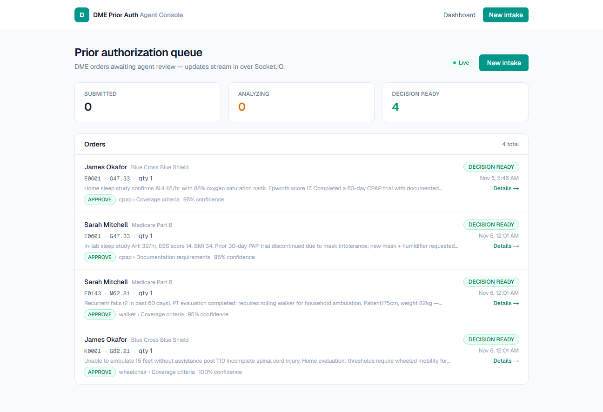

# dme-prior-auth-agent

Demo platform for a **Principal Full Stack Developer** application: an AI agent that
checks DME (durable medical equipment) orders against insurance policy documents and
drafts a prior-authorization recommendation — with a real-time operator dashboard.

## Architecture (evolving)

```
apps/web      Next.js 16 + Tailwind 4 + React 19   — intake form & agent monitor
apps/api      NestJS 12 (Node 24)                  — REST API / gRPC client
services/agent Python 3.13 + LangGraph             — RAG + LLM agent workflow
packages/shared TS contracts shared web ↔ api
docs/         plan/ and progress/ notes per build step
```

Runs fully local: **Ollama (phi4-mini + nomic-embed-text)** for LLM/embeddings,
Postgres, Redis, RabbitMQ, MinIO via Docker.

## Commands

```bash
docker compose up -d   # start Postgres (database-foundation step)
pnpm install           # install JS workspace
pnpm build             # turbo build (web + api)
pnpm lint              # turbo lint
pnpm dev               # turbo dev
```

## API

Base URL: `http://localhost:3001/api/v1`

| Method | Path                         | Description                           |
| ------ | ---------------------------- | ------------------------------------- |
| GET    | `/health`                    | status + db check                     |
| GET    | `/patients`                  | list patients (with order counts)     |
| GET    | `/patients/:id`              | patient with orders + decisions       |
| GET    | `/orders?status=&patientId=` | list orders, optional filters         |
| GET    | `/orders/:id`                | order with patient + decision         |
| POST   | `/orders`                    | create order (Zod-validated, audited) |

Errors are RFC 7807 `application/problem+json`. Run the API with
`pnpm --filter @dme/api start:dev`.

## Web app



- `/` — prior-authorization queue: status stats, orders with patient/insurance,
  HCPCS/ICD-10 codes, clinical note preview, 5-second refresh
- `/intake` — DME order form validated by the **same Zod schema as the API**; server
  problem details map back onto form fields

```bash
pnpm --filter @dme/web dev     # http://localhost:3000
```

`NEXT_PUBLIC_API_URL` defaults to `http://localhost:3001/api/v1` (see
`apps/web/.env.example`).

## Agent service

Python 3.13 FastAPI service, fully local LLM stack through Ollama:

- `phi4-mini` — schema-constrained clinical extraction
- `nomic-embed-text` — 768-dim embeddings for the policy RAG pipeline

| Method | Path       | Description                                     |
| ------ | ---------- | ----------------------------------------------- |
| GET    | `/health`  | Ollama reachability + active models             |
| POST   | `/extract` | clinical notes → structured facts (JSON-schema) |
| POST   | `/embed`   | text → embeddings (used by RAG ingestion)       |

```bash
cd services/agent
uv venv .venv
uv pip install --python .venv/Scripts/python.exe -r requirements.txt
.venv/Scripts/python.exe -m uvicorn app.main:app --reload --port 8000
```

### Policy RAG

Three synthetic payer policies (`services/agent/policies/`) are chunked by section,
embedded with `nomic-embed-text`, and stored in Postgres + **pgvector** (HNSW cosine
index). `POST /policies/search` returns scored policy sections with document/section
citations that the decision workflow uses.

```bash
docker compose up -d   # pgvector/pgvector:pg16
cd services/agent
.venv/Scripts/python.exe -m scripts.ingest_policies
```

## Docs

Step-by-step build decisions live in [`docs/`](docs/README.md).
