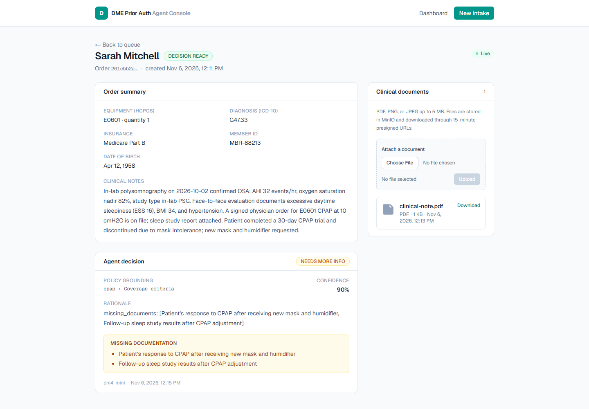

# dme-prior-auth-agent

Demo platform for a **Principal Full Stack Developer** application: an AI agent that
checks DME (durable medical equipment) orders against insurance policy documents and
drafts a prior-authorization recommendation — with a real-time operator dashboard.

## Architecture

```
apps/web      Next.js 16 + Tailwind 4 + React 19   — intake, queue & document console
apps/api      NestJS 12 (Node 24)                  — REST / events / gRPC / cache + storage
services/agent Python 3.13 + LangGraph             — RAG + LLM agent workflow & event worker
packages/shared TS contracts shared web ↔ api
docs/         plan/ and progress/ notes per build step
```

Runs fully local: **Ollama (phi4-mini + nomic-embed-text)** for LLM/embeddings,
Postgres + pgvector, RabbitMQ, Redis, MinIO via Docker.

## Run the demo

Prerequisites: Docker Desktop and Ollama with the two models pulled:

```bash
ollama pull phi4-mini
ollama pull nomic-embed-text
```

Then build the production-like stack and seed it:

```bash
cp .env.prod.example .env.prod   # PowerShell: Copy-Item .env.prod.example .env.prod
docker compose --env-file .env.prod -f docker-compose.prod.yml up -d --build
docker compose --env-file .env.prod -f docker-compose.prod.yml exec api pnpm exec tsx prisma/seed.ts
docker compose --env-file .env.prod -f docker-compose.prod.yml exec agent python -m scripts.ingest_policies
```

Open **http://localhost:3000**, create an order, and watch it move from `SUBMITTED`
through `ANALYZING` to `DECISION_READY`. The full runbook, environment table, and AWS
mapping are in [`docs/deployment.md`](docs/deployment.md).

The first build takes several minutes (three images). Host Ollama is the default;
`docs/deployment.md` covers the optional self-contained Ollama profile and troubleshooting
if the containers cannot reach the host model server.

## Local development

```bash
docker compose up -d   # start Postgres, RabbitMQ, Redis, MinIO
pnpm install           # install JS workspace
pnpm build             # turbo build (web + api)
pnpm lint              # turbo lint
pnpm dev               # turbo dev
```

## API

Base URL: `http://localhost:3001/api/v1`

| Method | Path                                    | Description                            |
| ------ | --------------------------------------- | -------------------------------------- |
| GET    | `/health`                               | status + db check                      |
| GET    | `/patients`                             | list patients (with order counts)      |
| GET    | `/patients/:id`                         | patient with orders + decisions        |
| GET    | `/orders?status=&patientId=`            | list orders, optional filters          |
| GET    | `/orders/:id`                           | order + patient, decision, documents   |
| POST   | `/orders`                               | create order (Zod-validated, audited)  |
| POST   | `/orders/:id/analyze-grpc`              | proxy to the agent's gRPC AnalyzeOrder |
| POST   | `/orders/:id/documents`                 | upload document (multipart, 5 MB)      |
| GET    | `/orders/:id/documents`                 | document metadata                      |
| GET    | `/orders/:id/documents/:documentId/url` | 15-minute presigned download           |

Errors are RFC 7807 `application/problem+json`. Run the API with
`pnpm --filter @dme/api start:dev`.

## Web app


- `/` — prior-authorization queue: status stats, live updates over Socket.IO (with a
  10s polling fallback), decision badges, patient/insurance and HCPCS/ICD-10 context
- `/intake` — DME order form validated by the **same Zod schema as the API**; server
  problem details map back onto form fields
- `/orders/[id]` — decision rationale, cited policy, missing documentation, and
  clinical-document upload/download; status changes stream in live



```bash
pnpm --filter @dme/web dev     # http://localhost:3000
```

`NEXT_PUBLIC_API_URL` defaults to `http://localhost:3001/api/v1` (see
`apps/web/.env.example`).

## Agent service

Python 3.13 FastAPI service, fully local LLM stack through Ollama:

- `phi4-mini` — schema-constrained clinical extraction
- `nomic-embed-text` — 768-dim embeddings for the policy RAG pipeline

| Method | Path       | Description                                     |
| ------ | ---------- | ----------------------------------------------- |
| GET    | `/health`  | Ollama reachability + active models             |
| POST   | `/extract` | clinical notes → structured facts (JSON-schema) |
| POST   | `/embed`   | text → embeddings (used by RAG ingestion)       |

```bash
cd services/agent
uv venv .venv
uv pip install --python .venv/Scripts/python.exe -r requirements-dev.txt
.venv/Scripts/python.exe -m uvicorn app.main:app --reload --port 8000
```

### Prior-auth workflow

`POST /orders/{id}/analyze` runs a LangGraph workflow over an existing order:

```
mark_analyzing → extract → retrieve policy → decide → persist
```

The decision is one of **APPROVE**, **NEEDS_MORE_INFO**, or **DENY**, includes a
rationale, the cited policy section, missing documents, and a confidence score, and
moves the order to `DECISION_READY` (or `FAILED`) with an audit trail. All inference
stays local through Ollama.

### Event-driven analysis

Creating an order publishes a confirmed `order.created` event to RabbitMQ
(topic exchange `dme.events`). A dedicated worker consumes it with prefetch 1 and runs
the same workflow, so intake responds immediately while analysis happens in the
background. The agent publishes `order.analyzing` / `order.analyzed` / `order.failed`;
the API relays all `order.*` events to the dashboard over Socket.IO. Failures are
rejected to a dead-letter queue; the HTTP endpoint remains available for manual retries.

```bash
# separate terminal, from services/agent
.venv/Scripts/python.exe -m app.consumer
```

RabbitMQ management UI: `http://localhost:15672` (`dme` / `dme`).

### Caching & document storage

Order reads are cache-aside in **Redis**: list keys (`orders:list:*`, 15s) and detail
keys (`orders:item:*`, 30s) are invalidated with `SCAN` on every write and every
`order.*` event. A Redis outage is only a cache miss — reads fall through to Postgres.

Clinical documents live in **MinIO** (`dme-clinical-documents`); Postgres stores the
metadata and audit row. Uploads are limited to 5 MB PDF/PNG/JPEG and downloads use
15-minute presigned URLs, so object-storage credentials never reach the browser. The API
uses the internal `minio` hostname for storage operations and `MINIO_PUBLIC_ENDPOINT`
(default `localhost`) when signing browser-facing URLs.

- MinIO console: `http://localhost:9001` (`dme` / `dme-local-secret`)
- S3 endpoint: `http://localhost:9000`
- The compose file pins a community mirror of the last MinIO release, because official
  MinIO images were removed from Docker Hub and Quay in 2026.

### gRPC

The workflow is also exposed over gRPC (`proto/agent.proto`, package `dme.agent.v1`)
for typed, language-neutral calls:

```bash
# separate terminal, from services/agent
.venv/Scripts/python.exe -m app.grpc_server     # :50051
.venv/Scripts/python.exe -m scripts.grpc_smoke <order-id>
```

NestJS loads the proto at runtime and calls it from
`POST /api/v1/orders/:id/analyze-grpc`, mapping gRPC statuses to HTTP errors.

### Policy RAG

Three synthetic payer policies (`services/agent/policies/`) are chunked by section,
embedded with `nomic-embed-text`, and stored in Postgres + **pgvector** (HNSW cosine
index). `POST /policies/search` returns scored policy sections with document/section
citations that the decision workflow uses.

```bash
docker compose up -d   # pgvector/pgvector:pg16
cd services/agent
.venv/Scripts/python.exe -m scripts.ingest_policies
```

## Testing

```bash
pnpm build && pnpm lint && pnpm test
pnpm --filter @dme/api test:e2e
cd services/agent && .venv/Scripts/python.exe -m pytest -q
```

The API e2e suite needs Postgres and uses the `pgvector/pgvector:pg16` image in CI;
Redis and MinIO are optional because the app degrades gracefully. The GitHub Actions
workflow lives in [`.github/workflows/ci.yml`](.github/workflows/ci.yml) and runs the
same gates on every push.

## Docs

Step-by-step build decisions live in [`docs/`](docs/README.md). Deployment, demo, and
cloud mapping notes are in [`docs/deployment.md`](docs/deployment.md).
