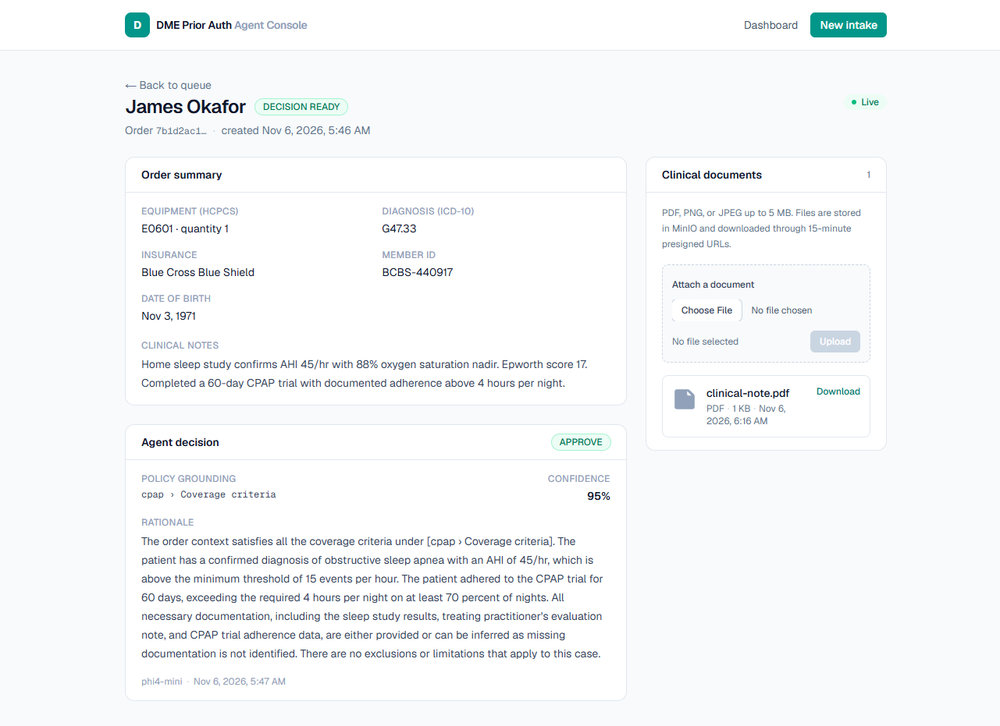

# Progress — Caching & Document Storage

**Step:** 11 of 13 · **Status:** ✅ done · **Date:** 2026-11-06

## What was built

```
docker-compose.yml                                  redis:7-alpine + pinned MinIO mirror + volumes
apps/api/src/cache/cache.service.ts                 ioredis client, JSON helpers, SCAN invalidation
apps/api/src/cache/cache.module.ts                  global cache module
apps/api/src/orders/orders.service.ts               cache-aside reads + document include
apps/api/src/realtime/realtime-events.consumer.ts   invalidate cache before broadcasting
apps/api/src/storage/storage.service.ts             MinIO client, bucket bootstrap, presign
apps/api/src/documents/documents.service.ts         validation, upload, list, presign, audit
apps/api/src/documents/documents.controller.ts      multipart + JSON endpoints
apps/api/src/documents/documents.module.ts
apps/api/prisma/schema.prisma                       ClinicalDocument model
apps/api/prisma/migrations/20261106110000_clinical_documents/
packages/shared/src/schemas/document.ts             ClinicalDocument contract
packages/shared/src/schemas/order.ts                OrderSchema.documents
apps/web/src/lib/api.ts                             upload + presigned-URL helpers
apps/web/src/app/orders/[id]/page.tsx               Suspense wrapper for the detail route
apps/web/src/app/orders/[id]/order-detail.tsx       order/decision/documents UI
apps/web/src/app/page.tsx                           Details links + row layout fix
```

Read path:

```
GET /orders      ─► orders:list:<status>:<patientId>  (TTL 15s) ─► Postgres
GET /orders/:id  ─► orders:item:<uuid>                (TTL 30s) ─► Postgres
                      ▲
create / upload / order.* event ─► SCAN + DEL ─┘
```

Document path:

```
browser ──multipart──► API ──validate (5 MB, PDF/PNG/JPEG)──► MinIO object
                          └── metadata + audit row in Postgres ──► order detail
browser ──GET .../url──► API ──presigned GET (900s)──► MinIO ──bytes──► browser
```

## Verification

| Check                 | Result                                                                                                                    |
| --------------------- | ------------------------------------------------------------------------------------------------------------------------- |
| Cache warm            | first `GET /orders` created `orders:list:all:all` with **TTL 15** ✅                                                      |
| Cache invalidation    | Redis `MONITOR` showed `SCAN orders:list:*` + `DEL` on create; the dashboard's live refetch then re-cached with TTL 15 ✅ |
| Realtime invalidation | the API consumer issued the same SCAN/DEL for `order.created` / `order.analyzing` ✅                                      |
| Redis outage          | `GET /orders` returned **HTTP 200 in 6 ms** while Redis was stopped; warning logged once; cache resumed after restart ✅  |
| Upload                | `POST /orders/:id/documents` → **201**, 858-byte PDF persisted with metadata (no `storageKey` in responses) ✅            |
| Object storage        | API startup created bucket `dme-clinical-documents` ✅                                                                    |
| Presigned download    | `GET .../url` returned `X-Amz-Expires=900`; downloaded SHA-256 **matched the upload** ✅                                  |
| MinIO outage          | upload returned **503 problem+json** (`Clinical document storage is unavailable`), no 500 ✅                              |
| Browser upload        | file chooser upload succeeded; list refreshed to 2 docs and showed “clinical-note.pdf uploaded.” ✅                       |
| Browser download      | Download button produced `clinical-note.pdf` (858 bytes); SHA-256 matched the source ✅                                   |
| Upload audit          | `audit_logs` row `document_uploaded`, actor `api`, with document id/name/type/size ✅                                     |
| API tests             | unit **2/2**, e2e **3/3** ✅                                                                                              |
| Build / lint          | shared build, Nest build, Next build, oxlint, ESLint green ✅                                                             |
| UI                    | detail page upload/download verified in the browser; console clean; screenshot below ✅                                   |



## Decisions in practice

- **Cache-aside, not write-through**: orders are written once by the agent/API and read
  often by the dashboard. TTLs only bound staleness if an invalidation is missed; every
  writer also invalidates explicitly.
- **Pattern invalidation via SCAN**: no Redis `KEYS` in the request path. List keys are
  namespaced (`orders:list:<status>:<patientId>`) so filters cannot serve stale rows.
- **Cache is optional**: ioredis errors never propagate; a stopped Redis is a cache miss,
  not an API outage. Reconnect retries are capped at 5s forever, and caching resumes
  automatically.
- **Metadata in Postgres, bytes in MinIO**: listings and permission checks stay SQL-fast;
  object keys never leave the API. Downloads use short-lived presigned URLs, so MinIO
  credentials stay server-side.
- **Validate both MIME and extension**: demo-level guard against renamed executables.
  Real deployments should add malware scanning and content sniffing.
- **Audit every PHI write**: uploads create an `audit_logs` row in the same transaction
  as the document metadata, matching the existing order/decision audit pattern.
- **Order detail is live**: it shares the Socket.IO hook, so a status change invalidates
  `['order', id]` and refetches; polling remains the fallback when disconnected.

## Deviations / gotchas

- **MinIO images disappeared in 2026.** Official `minio/minio` Docker Hub and Quay
  repositories are gone. The compose file pins the community mirror
  `ghcr.io/coollabsio/minio:RELEASE.2025-10-15T17-29-55Z`, which includes the
  CVE-2025-62506 fix. Documented in `docker-compose.yml`.
- **ioredis 6 needs a named import.** `import Redis from 'ioredis'` fails type-checking
  with NodeNext resolution; `import { Redis } from 'ioredis'` works at compile and runtime.
- **`multer` must be a direct dependency.** `@nestjs/platform-express` brings it
  transitively, but pnpm's strict layout makes the direct `memoryStorage` import fail at
  runtime unless it is declared.
- **The live dashboard can mask invalidation.** It refetches immediately after an event,
  so keys can reappear with a fresh TTL in the same second. Redis `MONITOR` was used to
  prove the SCAN/DEL sequence; the re-SET came from the browser's refetch.
- **Generated Prisma client is gitignored**; CI/deploy must run `prisma generate` before
  building the API.
- **No delete endpoint.** Documents can be uploaded and downloaded; removal is a future
  admin workflow (it must also remove the object, not just the row).

## Next step

`integration-testing-and-ci` — GitHub Actions for install/build/lint/test, API e2e with
Postgres, and Python tests; then deployment/demo readiness.
