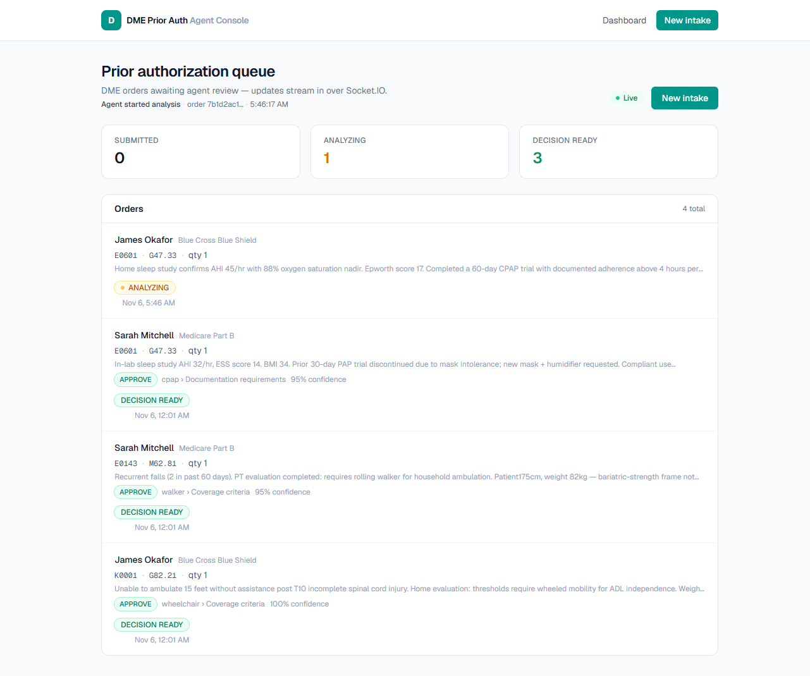

# Progress — Realtime Dashboard

**Step:** 10 of 13 · **Status:** ✅ done · **Date:** 2026-11-06

## What was built

```
services/agent/app/publisher.py                   aio-pika publisher (lazy, best effort)
services/agent/app/workflow.py                    order.analyzing / analyzed / failed events
services/agent/app/bootstrap.py                   publisher in the shared runtime
apps/api/src/realtime/orders.gateway.ts           Socket.IO gateway, /orders namespace
apps/api/src/realtime/realtime-events.consumer.ts RabbitMQ order.* → gateway relay
apps/api/src/realtime/realtime.module.ts
apps/web/src/lib/use-order-events.ts              socket hook + TanStack invalidation
apps/web/src/app/page.tsx                         live indicator, last event, decision badges
apps/api/src/orders/orders.service.ts             list orders with decisions
```

Event path:

```
API order.created ─┐
agent analyzing ───┼─► dme.events ─► api.dashboard (durable) ─► Socket.IO /orders ─► browser
agent analyzed ────┤                                                   │
agent failed ──────┘                                      invalidate ['orders'] / ['order', id]
```

## Verification

| Check              | Result                                                                                           |
| ------------------ | ------------------------------------------------------------------------------------------------ |
| Python tests       | **21/21** (lifecycle events on success and failure) ✅                                           |
| Socket connection  | gateway logged `dashboard connected`; UI shows **Live** ✅                                       |
| `order.created`    | new intake appeared in the open dashboard **without reload**; banner "Agent started analysis" ✅ |
| `order.analyzing`  | analyzing count 1, amber badge, screenshot `docs/assets/live-analyzing.png` ✅                   |
| `order.analyzed`   | banner "Decision ready", ready count 4, APPROVE + cited policy + 95% confidence ✅               |
| Browser console    | no errors ✅                                                                                     |
| End-to-end latency | created 5:46:17 → decision 5:47:25 (**68s**, local CPU) ✅                                       |
| Build / lint       | Next build, Nest build, ESLint, oxlint green ✅                                                  |
| Polling fallback   | 10s polling when the socket is disconnected (code path; socket path live-verified) ✅            |



## Decisions in practice

- **RabbitMQ is the single event spine**: order.created and agent lifecycle events all go
  through `dme.events`; the API's relay keeps Socket.IO decoupled from the agent's
  process model (HTTP, gRPC, or queue worker).
- **Durable dashboard queue**: the API can restart without losing notifications; a
  replayed event only causes an extra cache invalidation, which is harmless.
- **Query invalidation, not client-side state**: TanStack Query stays the source of
  truth; events just trigger refetches, so ordering and consistency remain simple.
- **Fallback polling**: 10s refresh only while disconnected; the UI is honest about its
  connection state instead of silently freezing.
- **Decision surface**: `GET /orders` now includes decisions so the dashboard shows
  outcome, cited policy, and confidence as soon as the event lands.

## Deviations / gotchas

- The Socket.IO CORS policy is `origin: true` for the local demo; production should
  allow only the deployed web origin.
- The API skips the RabbitMQ relay when `NODE_ENV=test` so unit/e2e tests do not need a
  broker; tests that need events can start the container and unset the guard.
- Events are best effort (as in step 8): a broker outage loses notifications, but the
  10s fallback polling still converges.
- The dashboard's stat label is uppercase `ANALYZING`, so text-based waits must target
  the row badge, not the label.

## Next step

`caching-and-document-storage` — Redis for hot order reads and MinIO for clinical
document uploads, with graceful fallbacks when either service is unavailable.
